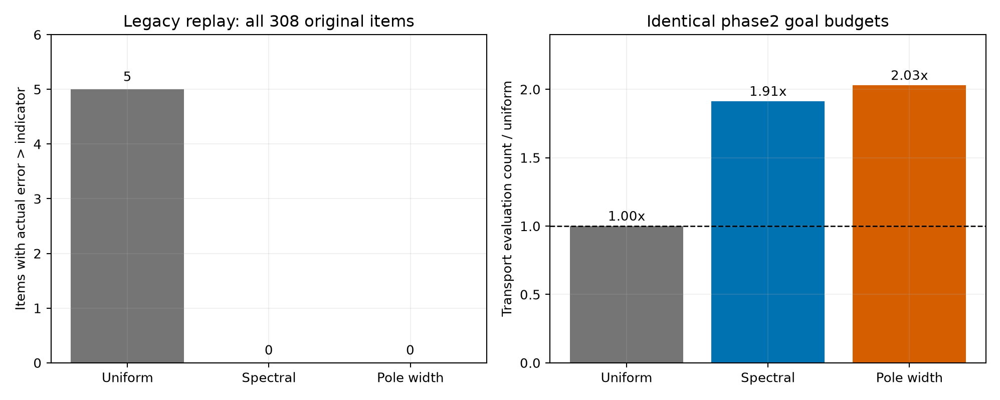

> 历史快照：本文件记录第三阶段交付时的状态。当前 GitHub 发布状态与最新结果以根目录 README 为准。

# RTD 研究第三阶段：共振定位的可靠性与成本

这是一套已经运行的数值研究包，延续上一阶段的误差估计问题。它适合个人电脑复现和导师讨论，尚不构成可投稿的新方法论文。本轮文件仅保存在本地，没有推送 GitHub。

TCAD（Technology Computer-Aided Design，工艺与器件计算机辅助设计）用数值模型研究半导体器件。这里采用 NEGF（Non-Equilibrium Green's Function，非平衡格林函数）计算开放器件中的相干输运；研究对象是 RTD（Resonant Tunneling Diode，共振隧穿二极管），利用双势垒或多势垒产生的窄透射峰检查能量积分。

## 已经得到的结果

- 24 个事先固定的主验证案例，加上单列的 12 个后续压力案例：三种方法均达到电流相对误差 0.1% 的目标。原始数据和参考值复核均保留。
- 按原目标预算重放上一阶段全部 308 个旧案例：原方法出现 5 次误差低估；两种谱引导方法均为 0 次。这是旧数据回归，不是新的独立验证，也不证明误差上界成立。
- 旧案例中，普通谱引导需要原方法 1.91 倍的能量点评估，增加极点宽度后需要 2.03 倍。更便宜的谱引导已经消除了这 5 次已知低估，新增极点步骤的必要性没有建立。
- 4 个压力案例触发参考计算的舍入警告或细分上限；用 50/80 位局部高精度计算和不同求积阶数复核后通过检查。不能把“计算精度设置得很小”当成参考解准确的证据。
- 11 项针对物理关系、独立求解和解析尖峰的测试通过。

先读 [导师视角审阅](docs/ADVISOR_REVIEW.md)，再看 [结果与修订](docs/RESULTS.md) 和 [方法推导](docs/METHODS.md)。可直接查看图：



## 运行

Python 3.12 为本轮实测环境。全部依赖为常规科学计算库，无商业软件和 GPU 要求。

```bash
python -m venv .venv
source .venv/bin/activate
python -m pip install -r requirements.txt
export OPENBLAS_NUM_THREADS=1
export OMP_NUM_THREADS=1
python -W error tests/test_phase3.py
python run_study.py
python run_study.py --protocol protocol_stress.json --results results_stress
python audit_precision.py
python check_legacy.py
python analyze.py
```

Windows 可使用 `.venv\Scripts\activate` 激活环境，再在终端设置对应线程环境变量。图像由程序自动保存。完整结果已包含在包内；只想重画图，可直接运行 `python analyze.py`。程序默认重写对应结果文件，建议在副本目录复现。参考计算会明显慢于单次候选方法，时间与电脑性能有关。

## 三种方法

| 名称 | 定位信息 | 作用 |
|---|---|---|
| uniform | 等宽初始面板 | 相同的 8/16 阶 Gauss 自适应求积基线 |
| spectral | 实部开放边界本征能量，固定细化尺度 | 检查已有谱引导思路是否已经足够 |
| pole | 谱初值与复数极点宽度，保留谱回退网格 | 检验加入共振宽度后的增量价值 |

复数共振极点写成 `z = E_res - i Γ/2`：实部提示共振位置，虚部给出衰减能量尺度。这里只用它安排积分网格，电流仍由完整实轴透射计算。Γ 仅在孤立、近似洛伦兹线形时接近 FWHM（Full Width at Half Maximum，半高全宽，用来描述峰的宽窄）。

本轮未增加自洽 Poisson equation（泊松方程，用电荷密度决定静电势）的反馈。模型保持恒定有效质量、预设线性偏压降、相干弹性输运，不包含散射、实验拟合或工艺校准。不能把能量积分准确等同于真实器件预测准确。

## 文件

- `protocol.json`、`protocol_stress.json`：主研究与后续压力研究的分开冻结配置。
- `src/resonance.py`：本征能量、复数极点定位及完整求解轨迹。
- `src/seeded.py`、`src/integration.py`：共用的自适应求积。
- `src/highprecision.py`：独立高精度行列式递推，仅用于参考值复核。
- `vendor/`：上一阶段冻结输运核与独立带状求解器，来源提交已注明。
- `results/`、`results_stress/`、`results_legacy/`：三个不同用途的数据组。
- `results_stress_attempt1/`：保留触发参考细分上限的未完成首次运行。
- `legacy_phase2/`：回归检查所需的旧协议、参考电流和目标停止规则。
- `docs/REPRODUCTION.md`：分步骤复现与答辩练习。
- `MANIFEST.sha256`：交付文件校验值；不包括 `.git` 和该清单自身。

文献已存在利用本征能量引导网格的方案。本包是独立实验实现，没有复刻论文完整求解器，也不宣称首次提出这类方法。来源与未完成比较见 [文献审计](docs/LITERATURE.md)。
