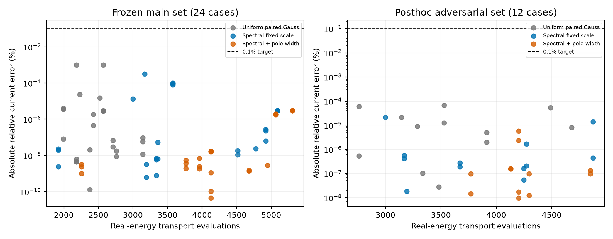
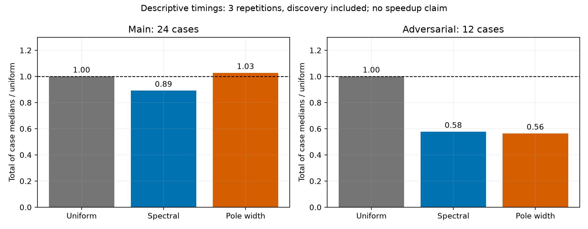
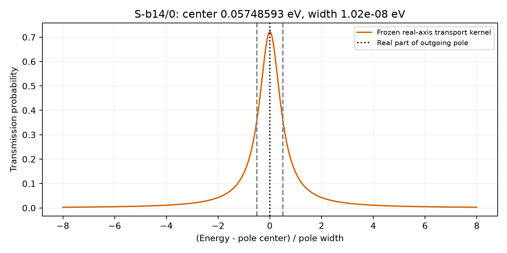

# 第三阶段结果与修订

结论：本轮重现并消除了旧案例中已知的 5 次误差低估现象，但代价较高；加入极点宽度的独立增量价值没有得到证明。项目已更接近可审查的研究过程，尚未形成可投稿的新方法贡献。

## 新案例

主研究包含 24 案例，后续压力研究 12 案例。后者在看到主研究结果后增加，单独冻结，没有再调候选算法。参考精度问题经单列的事后高精度复核处理后，36 案例均可评估。

所有方法的电流目标为相对误差 1e−3，即 0.1%，另加 1e−6 A/m² 的绝对容差。下表误差均为**无量纲比例，不是百分数**。

| 数据组 | 方法 | 达标 | 最大相对电流误差 | 实轴输运点评估 |
|---|---|---:|---:|---:|
| 主研究 24 | uniform | 24/24 | 9.9962e−6 | 59,712 |
| 主研究 24 | spectral | 24/24 | 3.1284e−6 | 89,592 |
| 主研究 24 | pole | 24/24 | 3.0196e−8 | 100,128 |
| 压力研究 12 | uniform | 12/12 | 6.6722e−7 | 42,816 |
| 压力研究 12 | spectral | 12/12 | 2.1444e−7 | 46,656 |
| 压力研究 12 | pole | 12/12 | 5.7816e−8 | 50,880 |

三种方法在这些案例中的经验误差指标均覆盖实际电流误差。普通自适应基线也全部达标，因此不能声称已经证明窄共振使其失效。极点法在主研究中精度更高，但目标本身远未要求这么高的精度，存在过度求解。

## 旧数据的同预算回归

本轮不仅检查新案例，还按原来的统计与设计目标停止规则，重放全部 11 个旧任务、308 个条件样本或设计候选。原协议、种子、参考电流和目标规则不变；参考值在算法停止后才被读取用于评估。

| 方法 | 已知误差低估项 | 任务达标 | 实轴输运点评估 | 相对原方法 |
|---|---:|---:|---:|---:|
| uniform | 5/308 | 11/11 | 713,376 | 1.00 |
| spectral | 0/308 | 11/11 | 1,364,640 | 1.91 |
| pole | 0/308 | 11/11 | 1,447,656 | 2.03 |

原方法的最坏实际误差/指标比为 16.7354；谱引导为 0.0790；极点引导为 0.0791。回归结果说明当前谱网格对这些已知案例有效，并不意味着未来误差覆盖率为 100%。两种新初始化得到更保守的结果，且更简单的方法已足够消除原 5 次低估，不能将其归功于极点步骤。

## 完整耗时

本征求解、极点求解、全部实轴积分都计入每次候选方法耗时，不将定位开销视为免费。复数残差调用数另记：主研究极点法共 610 次，压力研究 347 次。实轴点评估不能单独代表完整成本。

主研究每案例 3 次重复的中位耗时求和：uniform 0.2318 s，spectral 0.2067 s，pole 0.2381 s。压力研究分别为 0.2740、0.1581、0.1544 s。压力研究中谱法虽有更多能量点，但批量布局与减少细分可降低 Python 调度开销，这是实现层面的解释；尚未进行消融实验确认其独立贡献。

极点法相对谱法在压力研究中的耗时差仅约 2.3%，主研究反而较慢。单台机器、3 次短时间重复不足以认定稳定加速，更不能只选压力研究与弱基线比较来突出约 1.77 倍的表观优势。旧案例耗时仅单次，亦不作速度结论。

## 参考计算也需要验证

压力研究中 S-b12 的两个案例出现 QUADPACK 舍入警告；S-b14 的两个案例亦有参考精度问题，其中首次运行在细网格求积达到 2000 次细分后中断。未完成运行留存于 `results_stress_attempt1`。完整重跑只增加异常捕获，不改变候选积分器。

这 4 个案例随后采用局部高精度三对角行列式递推，比较 50 位＋10/20 阶和 80 位＋16/32 阶求积，并重新计算窗口外的双精度积分。四次复核均无窗口外警告；两个高精度版本的一致性约 9.1e−16 至 1.1e−15，原双精度参考与复核值的相对差最大约 1.13e−8。最终压力表的误差依据修正后的参考值重新计算；原始警告状态并未覆盖。

这种一致性仅是对本离散问题参考值的经验检查。不能理解为整个电流具有 15 位可靠数字，也不证明所有共振均被发现。复数极点和参考分段共享定位信息，仍有共同漏峰风险。

本轮接受的最小极点宽度约 9.46e−9 eV。下面展示一个约 1.02e−8 eV 的物理模型共振，曲线由实轴输运核直接计算。

## 对项目主张的修改

保留：开放输运模型、独立带状求解、谱定位、复数极点定位、高精度参考、原始轨迹与成本记录。这些组成可复现的数值研究工具。

收缩：不再把“消除 5 次已知低估”写作认证误差界；不将人工尖峰测试当作真实器件失效率；不把更多精度当作相同目标下的效率提升；不将既有谱引导方法包装成首创。

本轮未产出投稿稿件，也未上传或修改 GitHub 仓库。下一研究门槛见 [导师视角审阅](ADVISOR_REVIEW.md)；代码与数据可立即用于复现和组会讨论。
