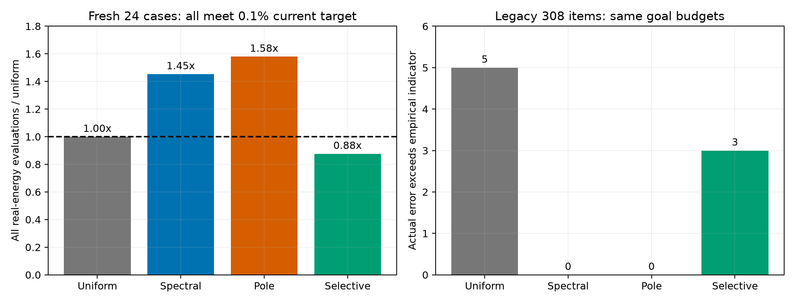

# 第四阶段：选择性谱引导能否降低可靠性成本？

完成了一个供给函数加权的选择性谱网格实验。结论是：新案例节省了计算，但旧回归仍有误差低估，因此**不能作为可靠默认算法**。

本轮为 8 个新结构/温度/偏压上下文各生成 3 个高度样本，共 24 个新案例，协议与实现均先于本轮输运结果提交到本地 git。另按旧目标预算重放 308 个旧样本/候选，明确属于回归检查。没有根据参考解调整在线停止条件。

## 结果

| 方法 | 新案例达标 | 新案例实轴点评估 | 旧案例低估项 | 旧案例实轴点评估 |
|---|---:|---:|---:|---:|
| uniform | 24/24 | 69,240 | 5/308 | 713,376 |
| spectral | 24/24 | 100,656 | 0/308 | 1,364,640 |
| pole | 24/24 | 109,416 | 0/308 | 1,447,656 |
| selective | 24/24 | 60,714 | 3/308 | 764,248 |

目标为电流相对误差 0.1%，另加 1e−6 A/m² 绝对容差。新方法在新案例中比 uniform 少约 12.31% 能量点，比完整谱法少约 39.68%；但旧数据中仍有 3 次误差低估，最坏比值为 16.74。不能用新案例均达标来忽略回归失败。



## 算法

先用每个初始面板 2 个 Gauss 点估算电流，再计算实部开放边界本征能量及一阶展宽。按 `π Γ0 S(E)/2` 估算共振供给加权面积，在候选窄模态中从小到大删去代理面积，累计删去量不超过候选目标容差的 1%。宽模态交给普通自适应求积，保留模态沿用第三阶段的谱网格。

这些面积是**经验代理量，不是误差上界**。宽度筛选、峰位偏移和多峰耦合都可能让选择策略失效。初始粗采样的 3,018 个输运能量点全部计入新案例成本，没有把丢弃的预计算隐藏掉。162 个本征初值保留 33 个。

完整耗时包括粗采样、本征求解和积分。3 次短重复的每案例中位耗时之和分别约 0.375、0.326、0.336、0.247 s；只作为本机描述性记录，不宣称稳定加速。旧回归耗时仅一次。

## 参考值与测试

参考值由独立带状求解＋QUADPACK 与细网格求积比较。3 个新案例触发双精度参考问题，转为 50/80 位局部高精度复核。所有原始警告和复核字段都保留在 `results/references.csv`。极点用于参考分段，有共享定位信息，因此这不是完整漏峰保证。全部 24 个参考值通过本轮经验质量检查。

新增 6 项测试通过；连同第三阶段 11 项共 17 项。分别运行：

```bash
# 在仓库根目录
python -W error tests/test_phase3.py
python -W error phase4/tests/test_selective.py
python phase4/run_phase4.py
python phase4/analyze_phase4.py
```

`run_phase4.py` 自动保存新验证与旧回归数据；运行会重写本轮结果，建议在副本中复现。全部依赖见仓库根目录 `requirements.txt`。

## 导师视角的修订

把本轮从“可靠高效的新算法”修改为“目标达标、经验指标覆盖与成本之间的可复现对照”。最重要的发现不是更多复杂功能，而是**新验证上节省计算并不意味着旧可靠性问题得到解决**。更简单的完整谱法必须保留为基线。

TU Wien 的 Pourfath 博士论文早已讨论过自适应网格的误差估计，以及非线性共振求根的成本和邻近窄峰定位问题。[原文 §4.8.3](https://www.iue.tuwien.ac.at/phd/pourfath/node87.html)。因此本轮也不以“发现共振定位有成本”作为创新。完整文献方法的比较与新颖性论证仍未完成，当前不具备新方法论文投稿依据。

可继续做选择失效机制的消融，但应先冻结实验条件；不能一边查看参考误差一边更改筛选规则，再把同一组案例叫作新验证。
